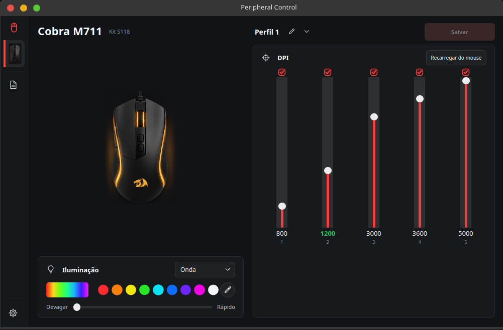

# Peripheral Control

Configure DPI e iluminação de periféricos USB HID no Linux, com edição local e aplicação somente ao clicar em **Salvar**.



_Print da aplicação conectada ao Cobra M711 no Linux._

## Instalação

O ambiente de referência é **Arch Linux**. Em outras distribuições, o instalador pergunta se deseja continuar, com **Não** como padrão.

Baixe o repositório (ou extraia o ZIP do GitHub) e execute:

```bash
git clone https://github.com/LucasLouvem/Peripheral-Control.git
cd Peripheral-Control
./scripts/install.sh
```

O instalador prepara o ambiente Python isolado, configura o acesso ao mouse e cria um ícone **Peripheral Control** no menu de aplicativos. Usa sudo somente quando precisa de pacotes do sistema ou da regra udev; não execute o instalador inteiro como root.

Depois, abra pelo menu ou abra um novo terminal e execute `hidctl-gui` de qualquer diretório. O instalador configura `~/.local/bin` no PATH do seu shell. Para explorar sem hardware, use `hidctl-gui --demo`.

## Atualização

Feche a ferramenta e execute:

```bash
hidctl-gui --update
```

A atualização busca a `main` oficial, valida a nova instalação e só então a ativa. Falhas de preparação preservam a versão anterior e os dados pessoais.

## Desinstalação

Feche a ferramenta e execute:

```bash
hidctl-gui --uninstall
```

Confirme a desinstalação quando solicitado. Preferências e backups são preservados; a remoção da regra de acesso ao mouse é opcional.

Para **apagar também todas as preferências e backups**, use:

```bash
hidctl-gui --uninstall A
```

Essa opção pede confirmação e apaga os dados definitivamente. Também remove a regra de acesso do projeto, se ela ainda corresponder à instalada, solicitando sudo.

## Saiba mais

- [Dispositivos compatíveis e limitações](docs/dispositivos_compativeis.md)
- [Como contribuir](docs/como_contribuir.md)
- [Instalação e atualização](docs/instalacao.md)
- [Funcionamento e protocolos](docs/README.md)

[Licença MIT](LICENSE). Projeto independente, sem afiliação aos fabricantes.
